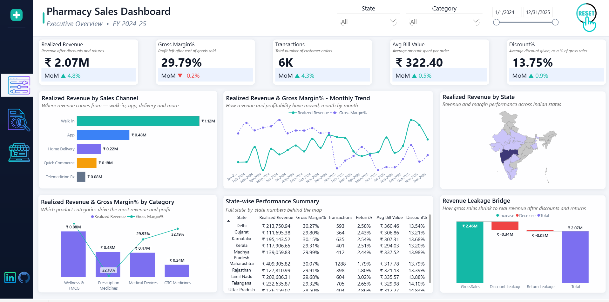
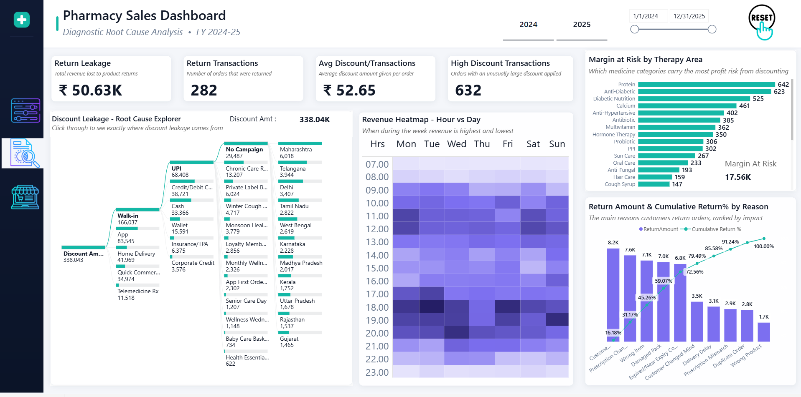
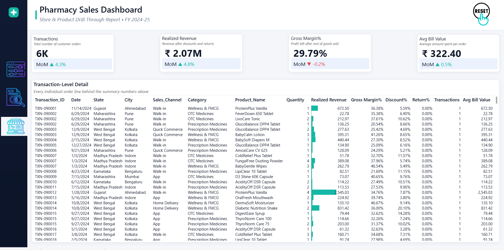

# Pharmacy Sales Dashboard

*An end-to-end Power BI project analyzing pharmacy retail sales — revenue performance, discount and return leakage, and store/product-level detail.*

## Overview

This project turns raw, line-item-level pharmacy transaction data into a three-tier analytics report — an executive summary, a root-cause diagnostic layer, and a full transaction drill-through — the same strategic → tactical → operational structure used in production BI reporting, rather than a single flat report.

- **~9,000 transaction rows**, line-item grain, spanning 2024–2025
- **Star schema data model**: 1 fact table, 10 dimension tables, plus a disconnected helper table used to control a waterfall chart's step order
- **~39 DAX measures** across two measure tables, with a consistent naming pattern for prior-period and variance calculations
- **Custom Power BI theme** (navy + teal palette), applied report-wide instead of a stock theme
- **A cinematic Home page**, built with the HTML Content (lite) custom visual — animated title, a rotating data-ring, and navigation into the report

## Pages

### 📊 Executive Overview

Top-line KPIs (Realized Revenue, Gross Margin%, Transactions, Avg Bill Value, Discount%), revenue by sales channel, a monthly revenue/margin trend, a category breakdown, a state-level map, and a revenue "leakage" waterfall showing how Gross Sales shrinks down to Realized Revenue after discounts and returns.

### 🔍 Diagnostic Root Cause Analysis

An interactive decomposition tree tracing discount leakage through Sales Channel → Payment Mode → Campaign → State, an hour-by-day revenue heatmap, a "Margin at Risk" breakdown by therapy area, and a Pareto-style chart ranking return reasons by cumulative impact.

### 🧾 Store & Product Drill-Through

Full transaction-level detail behind the summary numbers on the other two pages — every order line, filterable and reachable by drilling through from either one.

## Key findings from the dashboard

- **"Prescription Changed" is the single largest return reason**, accounting for roughly 40% of total return value.
- **Maharashtra leads all states by a wide margin** in realized revenue.
- Discount leakage is concentrated in specific channel, payment, and campaign combinations — traceable directly through the decomposition tree rather than just a single leakage number.

## Data model

One fact table (`Fact_Sales`) at line-item grain, connected to ten dimension tables (Store, Product, Customer, Date, Payment, Channel, Campaign, Return Reason, Prescription Status, Inventory Status), plus a small disconnected table used only to control the display order of the revenue bridge waterfall.

## Tech stack

Power BI Desktop · DAX · Power Query · a custom Power BI theme (JSON) · HTML Content (lite) custom visual · Excel (source data)

## What I'd add next

- Year-over-year comparisons — the underlying data spans two years, but the current measures only compare month-over-month.
- Two dimensions that are already modeled but not yet surfaced in a chart: inventory stockout/expiry risk, and prescription fill-status (which may partly explain the "Prescription Changed" return pattern above).

## About the data

The dataset is a synthetic sample built to resemble real pharmacy retail operations — transactions, stores, products, prescriptions, campaigns. It is not real business or patient data.

## Connect

**Bhushan Wanjale**
LinkedIn: [@BhushanWanjale](https://www.linkedin.com/in/bhushan-wanjale/)
Interactive Dashboard: [@PharmacySalesDashboard]([https://www.linkedin.com/in/bhushan-wanjale/](https://app.powerbi.com/view?r=eyJrIjoiYWZkM2VhZWQtYTYxNS00OGE0LTg3NzUtNGVmMDE5ZWQ2MTE5IiwidCI6ImViOTFmNTI1LTBjZjgtNDk2MC1iNjY3LWM4MzYwYzQ2ZmRhYyJ9&pageName=b4fd23235bea9255800f))
